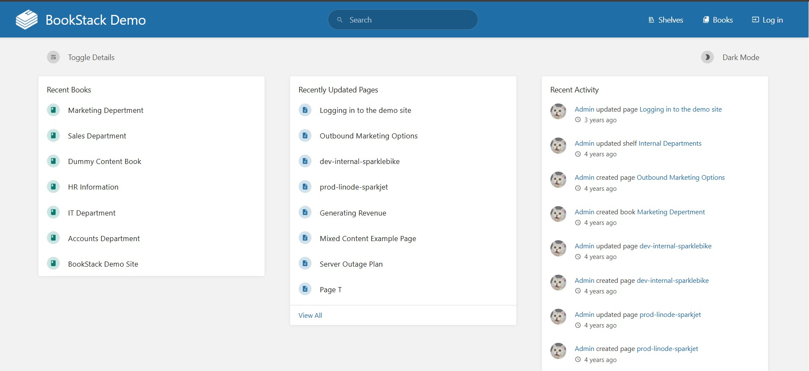
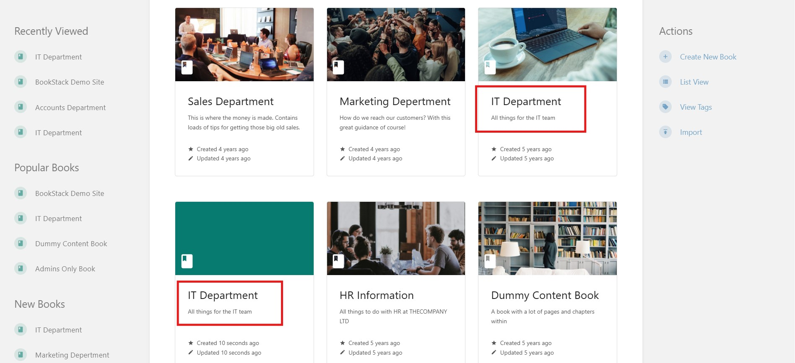
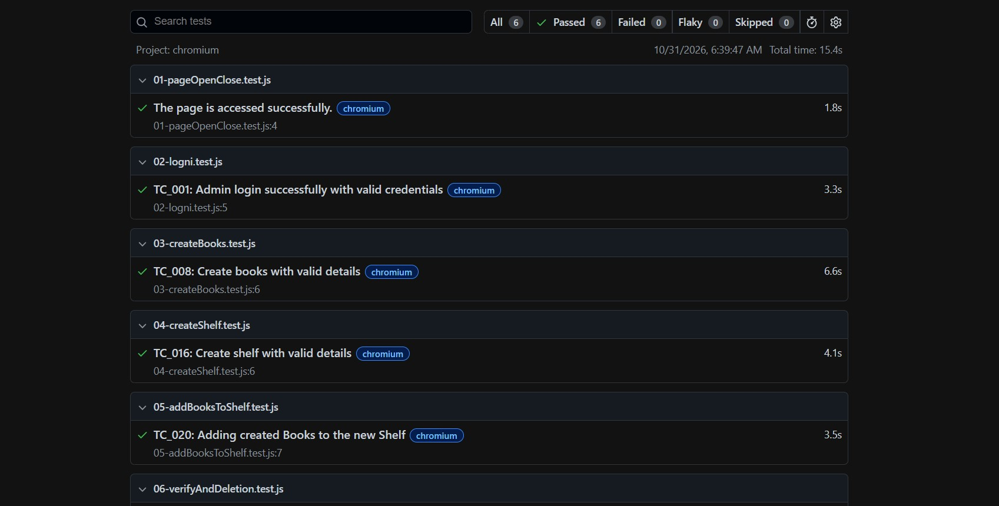
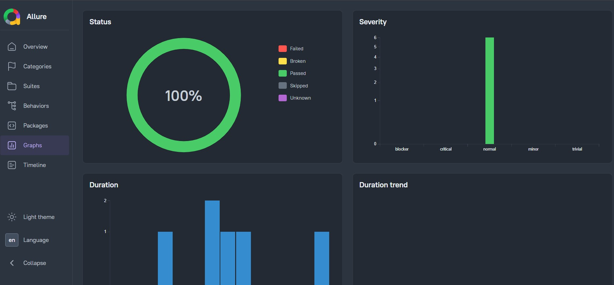

# BookStack Demo Web Testing

A web application testing project focused on evaluating the functionality of the BookStack Demo application through manual testing and end-to-end test automation using Playwright.

## Project Overview

The objective of this project is to evaluate the core functionalities of the BookStack Demo web application, identify potential defects and verify important user workflows through structured manual and automated testing.
The project covers test planning, test case design, test execution, defect reporting and automation test implementation.

## Application Under Test

| Information | Details |
|---|---|
| Application Name | BookStack |
| Application Type | Web Application |
| Application URL | https://demo.bookstackapp.com/ |
| Testing Approach | Functional Testing |
| Testing Types | Manual Testing and Automation Testing |
| Automation Tool | Playwright |
| Programming Language | JavaScript |



## Testing Scope

- Admin Login
- Book Creation and Management
- Shelf Creation and Management
- Adding Books to a Shelf
- Homepage Search Functionality
- Shelf and Associated Books Verification
- Data Integrity

## Testing Activities

### Test Planning

A test plan was prepared to define the testing objectives, scope, approach, test scenarios, test environment, entry and exit criteria and execution process.

### Manual Testing

A total of 30 test cases were designed and executed using the following testing techniques:

- Positive Testing
- Negative Testing
- Boundary Value Analysis
- Edge Case Testing
- Data Integrity Testing
- Error Handling Testing

**Manual Test Execution Results:**

| Metric | Result |
|---|---:|
| Total Test Cases | 30 |
| Passed | 28 |
| Failed | 2 |
| Pass Rate | 93.33% |

### Bug Reporting

Potential defects identified during manual testing were documented with relevant information to support investigation and reproduction.

Each bug report includes:
- Bug ID and Title
- Preconditions
- Steps to Reproduce
- Expected Result
- Actual Result
- Severity and Priority
- Supporting Evidence

A bug evidence


### Test Automation

Three important end-to-end scenarios were selected for automation using Playwright with JavaScript.

**Scenario 1: Login Functionality**
- Navigate to the BookStack Demo application.
- Log in using valid credentials.
- Verify successful login and access to the application.

**Scenario 2: Book and Shelf Management**
- Create two books.
- Create a new shelf.
- Add a book to the shelf.
- Verify that the books are associated with the correct shelf.

**Scenario 3: Shelf Search and Verification**
- Search for the created shelf from the homepage.
- Verify that the correct shelf appears in the search results.
- Open the shelf.
- Verify that both associated books are displayed.

**Why These Scenarios Were Selected for Automation:**

These scenarios represent important application workflows that require multiple user interactions and validations. Automating them reduces repetitive manual effort, improves execution efficiency and supports consistent verification of critical functionalities.

**Automation Test Execution Results:**

| Metric | Result |
|---|---:|
| Total Test Cases | 6 |
| Passed | 6 |
| Failed | 0 |
| Pass Rate | 100% |

## Technology Stack

| Tool / Technology | Purpose |
|---|---|
| Playwright | End-to-end test automation |
| JavaScript | Automation scripting |
| Microsoft Excel | Test case design and execution tracking |
| Markdown | Test documentation |
| Git | Version control |
| GitHub | Repository and project management |

## Repository Structure

```text
BookStackDemo_WebTesting/
│
├── 01_Test_Plan/
│   └── Test planning documentation
│
├── 02_Manual_Testing/
│   └── Manual test cases and execution results
│
├── 03_Bug_Reporting/
│   └── Documented bug reports and evidence
│
├── 04_Automation_Testing/
│   └── Automation test scenarios and Playwright scripts
│
├── 05_Test_Reports&Summary/
│   └── Overall test reports and summary
│
└── README.md
```

## How to Perform Manual Testing

1. Open the [BookStack Demo Application](https://demo.bookstackapp.com/).
2. Access the demo administrator credentials provided on the demo page.
3. Log in to the application.
4. Navigate through the application functionalities included in the testing scope.
5. Follow the preconditions and test steps documented in the `02_Manual_Testing` folder.
6. Compare the actual results with the expected results.
7. Record the execution status and document any reproducible defects.

**Note:** The public demo database and image storage are automatically reset every 30 minutes. Test data may therefore need to be recreated before execution.

## How to Run Automation Tests

The automation tests are implemented using Playwright with JavaScript.

### Prerequisites

- Node.js
- npm
- Playwright browsers

Verify Node.js and npm installation:

```bash
node --version
npm --version
```

### Installation

Clone the repository:

```bash
git clone https://github.com/humayrasiddika22/BookStackDemo_WebTesting.git
```

Navigate to the automation testing directory:

```bash
cd BookStackDemo_WebTesting/04_Automation_Testing
```

Install project dependencies:

```bash
npm install
```

Install Playwright browsers:

```bash
npx playwright install
```

### Running Tests

Run all automation tests:

```bash
npx playwright test
```

Run tests with the browser visible:

```bash
npx playwright test --headed
```

Run a specific test file:

```bash
npx playwright test < test-file-name >
```

**Note:** Replace `< test-file-name >` with the actual test file name available in the automation testing folder.

### Viewing Test Reports

The project is configured with the Playwright HTML reporter, run:

```bash
npx playwright show-report
```



Allure Report; Run the tests, then:
Generate the Allure report:

```bash
allure generate allure-results --clean -o allure-report
```

Open the Allure report:

```bash
allure open allure-report
```



The report provides information about test execution, including passed and failed tests.

## Overall Test Execution Summary

| Testing Type | Total | Passed | Failed |
|---|---:|---:|---:|
| Manual Testing | 30 | 28 | 2 |
| Automation Testing | 6 | 6 | 0 |

**Execution Pass Rate: 94.44%**

## Project Deliverables

- Test Plan
- Manual Test Cases
- Manual Test Execution Results
- Bug Reports
- Automation Test Scenarios
- Playwright Automation Scripts
- Test Reports and Overall Test Summary

## Conclusion

This project provided practical experience in software quality assurance through test planning, functional testing, test case design, test execution, defect reporting and end-to-end test automation. Combining manual and automated testing helped evaluate the application's core workflows, identify potential issues and verify important functionalities.

## Repository

[BookStack Demo Web Testing - GitHub](https://github.com/humayrasiddika22/BookStackDemo_WebTesting)

## Author

**Humayra Siddika**

[GitHub Profile](https://github.com/humayrasiddika22) | [LinkedIn Profile](https://www.linkedin.com/in/humayra-siddika/)
